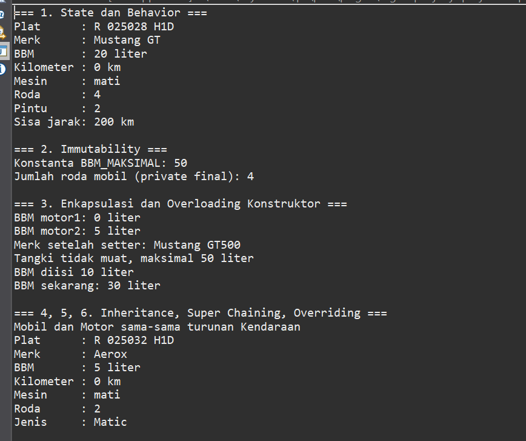
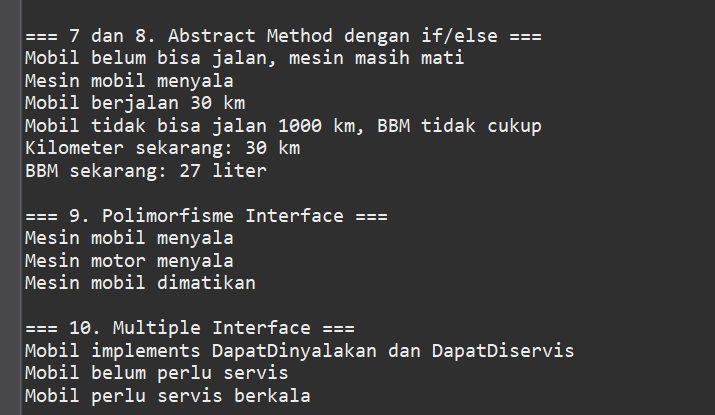

# Responsi Akhir Praktikum PBO - Sistem Kendaraan (Otomotif)

## Identitas
- Nama: Irsyad Palupi Sidqi Musdiarto
- NIM: H1D025028
- Tema (digit terakhir NIM 8): Otomotif
- Mata Kuliah: Praktikum Pemrograman Berorientasi Objek
- Program Studi: Informatika, Fakultas Teknik, Universitas Jenderal Soedirman

## Deskripsi Singkat
Program Java sederhana untuk mengelola kendaraan (mobil dan motor): menyalakan mesin, mengisi BBM, berjalan, dan servis.

## Struktur Class
| File | Keterangan |
|---|---|
| `Kendaraan.java` | Abstract class (superclass) |
| `Mobil.java` | Subclass Kendaraan, implements `DapatDinyalakan` dan `DapatDiservis` |
| `Motor.java` | Subclass Kendaraan, implements `DapatDinyalakan` |
| `DapatDinyalakan.java` | Interface (nyalakan, matikan) |
| `DapatDiservis.java` | Interface (servis) |
| `Main.java` | Pengujian 10 persyaratan |

## Cara Compile dan Run (Terminal)

### Prasyarat
Java Development Kit (JDK) sudah terpasang. Cek dengan perintah:
```bash
javac -version
```
Jika muncul versi Java (misalnya `javac 21`), JDK siap dipakai.

### Langkah-langkah
1. Unduh atau clone repositori ini, lalu simpan semua file `.java` dalam satu folder.
2. Buka terminal (Command Prompt, PowerShell, atau Terminal), lalu masuk ke folder tersebut:
   ```bash
      cd Irsyad_Palupi_Sidqi_Musdiarto_H1D025028_Shift_A_Shift_B_Paket_5
   ```
3. Compile semua file Java:
   ```bash
   javac *.java
   ```
   Jika berhasil, tidak ada pesan error dan muncul file `.class` di folder yang sama.
4. Jalankan program melalui class `Main`:
   ```bash
   java Main
   ```
5. Output program akan tampil di terminal, berisi pengujian kesepuluh persyaratan secara berurutan (bagian `=== 1 ===` sampai `=== 10 ===`).

## Screenshot Luaran Program




